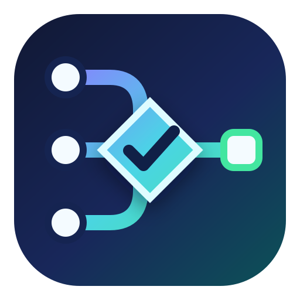

<p align="center"></p>

# FlowFoundry

**One goal. The smallest sufficient AI execution path.**

FlowFoundry is a local, open-source coordination layer for human–AI work. It reads relevant project context, chooses an eligible executor, runs the task within a permission ceiling, checks the result, and keeps evidence for the next session. You remain responsible for consequential actions.

**中文：**给它一个目标，FlowFoundry 会读取相关项目决定、选择足够用的 AI 执行路径、检查结果并保存证据。发布、部署、付款和权限变更仍由人决定。

```text
Your goal → relevant project context → eligible worker → execution → checks → result + evidence
```

> **Alpha developer preview.** The local CLI and Codex execution path are the primary supported route. Other providers depend on their own CLI, account permissions, and live verification. The desktop File Bridge is a scaffold, not a finished cross-platform sync product. See [current status](docs/CURRENT_STATUS.md).

## Try it in a local repository

Requires Python 3.11+, Git, and an installed, authenticated Codex CLI.

```bash
git clone https://github.com/ryanshi1103/ai-workflow-foundry.git
cd ai-workflow-foundry
python3 -m venv .venv
. .venv/bin/activate
python -m pip install -e .
flowfoundry validate
flowfoundry do "review this repository and identify one concrete improvement" --read-only
```

For a write task, use `flowfoundry do "fix the failing test in this repository"` in the repository you want to change. `flowfoundry status`, `flowfoundry result <task>`, and `flowfoundry cancel <task>` manage local background work. `flowfoundry ask "What did we decide about X?"` retrieves accepted project context. Run `flowfoundry --help` for the current command list.

The first command should be tried with a small, non-sensitive repository. Provider calls may incur the provider's normal usage or charges; FlowFoundry does not grant model access.

## What is different

| Problem | FlowFoundry's approach |
|---|---|
| Every task summons an oversized AI team | Choose the minimum sufficient eligible path; simple coding work can use one worker. |
| Context is copied between sessions | Select relevant project decisions and save a compact, traceable handoff. |
| An agent says “done” without proof | Keep its answer separate from the evaluator; mark the result PASS, PARTIAL, FAIL, or UNKNOWN from evidence. |
| An interrupted task loses its place | Persist local run state and expose status, result, cancellation, and continuation. |
| AI takes consequential actions implicitly | Stop at an explicit human approval boundary. |

FlowFoundry coordinates existing tools. It does not train a model or replace the underlying executor. See [core concepts](docs/CORE_CONCEPTS.md) for the ownership and evidence model.

## Inside this repository

- `src/flowfoundry/`: goal routing, execution, evidence, evaluation, CLI, and workspace integration.
- `core/workspace-manager/`: the local `cc` project launcher and deployment source. It has its own setup and tests.
- `applications/flowfoundry-desktop/`: Windows/Linux desktop scaffold for a future file bridge. Current native diagnostics are Linux-only.
- `components/confera-media-skills/`: portable media workflow skills.
- `workflows/print-ready-nameplate-generator/`: a deterministic document workflow.
- `applications/mediaflow/`: a synthetic public application contract, not private product source.

The desktop plan targets Windows and Linux computers plus iPhone and Android phones. The current Linux/iPhone SMB setup is a manually configured device workflow; it does not prove the desktop app can configure or sync four platforms. See the [File Bridge status](applications/flowfoundry-desktop/README.md).

## Development

```bash
PYTHONDONTWRITEBYTECODE=1 PYTHONPATH=src python3 -m unittest discover -s tests -v
python3 -m compileall -q src
git diff --check
```

Additional component checks and platform prerequisites are in [CONTRIBUTING.md](CONTRIBUTING.md). The project is MIT licensed; bundled components with their own licenses retain those notices. No credential, private session, customer data, or real personal media belongs in a contribution.

## Help build it

Useful first contributions include a reproducible Linux or Windows setup report, a focused test for a routing or recovery edge case, accessibility feedback on the terminal UI, and a small documentation fix that removes an ambiguity. Larger proposals should start with an issue that states the user problem, current behavior, intended behavior, and how success can be tested.

Read [the contributor guide](CONTRIBUTING.md), [code of conduct](CODE_OF_CONDUCT.md), and [security policy](SECURITY.md). If the project is useful, a GitHub star helps others find it; a concrete issue or tested pull request helps it improve.
