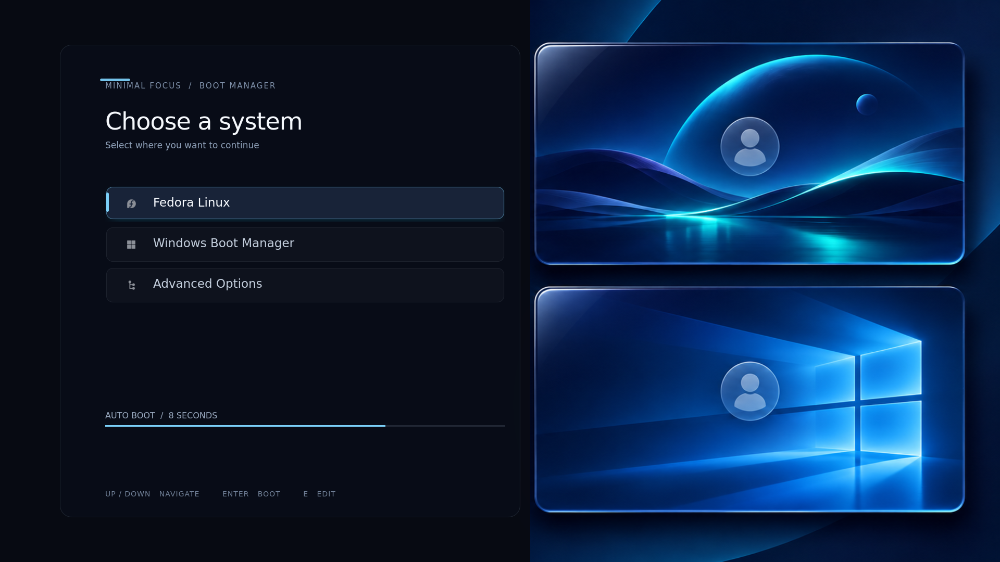

<p align="center">
  
</p>

<h1 align="center">Minimal Focus GRUB2 Theme</h1>

Minimal Focus is a Fedora-focused GRUB2 theme built around one calm,
asymmetric control surface. It keeps the screen visually quiet while making
keyboard navigation, selection, and the automatic boot countdown feel like
one continuous interaction.

In FlowFoundry this is an optional host visual component. Installing FlowFoundry
does not install the GRUB theme; the scripts below remain a separate privileged
operation. The theme does not update or remove Linux kernels or Windows files.
This component was imported from local `System` commit
`e3605ec8d7f353820697426921dafd21652f9c1f` as a source snapshot. Its
former repository history was not merged into the FlowFoundry commit graph.

It is a GPL-3.0 derivative of
[vinceliuice/grub2-themes](https://github.com/vinceliuice/grub2-themes),
using the upstream Vimix/Tela component structure, PF2 fonts, icon naming,
resolution profiles, and installation approach rather than replacing them
with an unrelated `theme.txt`.

Pinned upstream revision:

```text
80dd04ddf3ba7b284a7b1a5df2b1e95ee2aad606
```

## Preview



The preview demonstrates these existing GRUB menu titles:

- Fedora Linux
- Windows Boot Manager
- Advanced Options

The theme does not create, rename, hide, or reorder boot entries. Real labels
come from Fedora's current GRUB/BLS configuration. A machine may therefore
show complete kernel versions, rescue entries, firmware settings, multiple
Fedora kernels, or no Advanced Options submenu.

## Design research

The visual system was compared against several working open-source themes:

- [Grub EvoDevo](https://github.com/ftonneau/grub-evodevo) for its continuous
  menu/countdown composition and high-quality type experiments. Its baked
  per-entry PNG technique was deliberately not adopted because Fedora kernel
  updates would require regenerating the theme.
- [HyperFluent GRUB Theme](https://github.com/Coopydood/HyperFluent-GRUB-Theme)
  for clear keyboard affordances and resolution-aware layout.
- [Poly Dark](https://github.com/shvchk/poly-dark) for a restrained dynamic
  entry list with one obvious focus state.
- [vinceliuice/grub2-themes](https://github.com/vinceliuice/grub2-themes) for
  the mature Fedora-compatible engineering base retained by this project.

No visual asset or source code from the first three projects is bundled.

## Design

- Deep blue-black canvas with a quiet left control surface and a right-side
  two-system login-style preview rendered from the bundled source artwork.
- An asymmetric glass-like control surface gives the interface a clear
  compositional anchor while leaving deliberate negative space.
- Resting entries form a quiet stack of translucent rows; the current entry
  gains depth, a fine cyan border, and a narrow focus rail instead of becoming
  a loud solid-color button.
- Display-sized heading, compact utility copy, menu text, countdown, and
  keyboard hints follow a consistent typographic scale.
- A live cyan timeout baseline connects the menu to automatic boot.
- Small neutral OS/function icons, derived from the upstream icon map.
- DejaVu-based PF2 menu fonts replace the rougher default Unifont appearance.
- No animation, personal account data, or dense status dashboard.

The right-side artwork is static. GRUB keeps the menu entries and selected-row
focus dynamic; changing the large preview in response to Up/Down is not a
standard theme feature. `visuals/dual-os-login-art.png` is the source image;
`scripts/render-assets.sh` produces all five background profiles from it.

GRUB2's proven `item_pixmap_style` and `selected_item_pixmap_style` properties
apply a real nine-slice PNG focus surface to each dynamic entry. The selected
surface in the preview is not painted into the background.

## Upstream features retained

- `boot_menu` and percentage-based layout logic from Vimix/Tela.
- Terminus and Unifont PF2 fonts.
- 76 icon names at 32, 48, and 64 pixels.
- 1080p, 2K, 4K, ultrawide, and ultrawide-2K profiles.
- Resolution-specific focus surfaces, progress assets, icons, fonts, and
  backgrounds.
- Theme payload and installation logic kept separate.

## Project structure

```text
grub-x-minimal-theme/
├── visuals/                     # source artwork for the right-hand preview
├── theme/
│   ├── theme.txt                  # default 1080p source profile
│   ├── background.png
│   ├── cards/                     # focus and progress nine-slices
│   ├── icons/
│   ├── fonts/
│   ├── config/                    # five derived theme.txt profiles
│   ├── backgrounds/               # exact-size gradient PNG files
│   └── assets/                    # 1080p/2K/4K resource tiers
├── scripts/
│   ├── install.sh
│   ├── uninstall.sh
│   ├── backup.sh
│   └── render-assets.sh
├── preview/
│   └── minimal-focus-1080p.png
├── tests/
│   ├── validate.sh
│   └── build-standalone.sh
├── LICENSE
└── THIRD_PARTY_NOTICES.md
```

## Install on Fedora

Read the scripts before running them:

```bash
less scripts/install.sh
less scripts/backup.sh
less scripts/uninstall.sh
```

Install the default 1920x1080 profile:

```bash
sudo ./scripts/install.sh
```

Select another retained upstream-style profile:

```bash
sudo ./scripts/install.sh --screen 2k
sudo ./scripts/install.sh --screen 4k
sudo ./scripts/install.sh --screen ultrawide
sudo ./scripts/install.sh --screen ultrawide2k
```

Available modes:

| Profile | Requested GRUB mode | Asset density |
|---|---:|---:|
| `1080p` | 1920x1080x32, then `auto` | 32 px icons |
| `2k` | 2560x1440x32, then `auto` | 48 px icons |
| `4k` | 3840x2160x32, then `auto` | 64 px icons |
| `ultrawide` | 2560x1080x32, then `auto` | 32 px icons |
| `ultrawide2k` | 3440x1440x32, then `auto` | 48 px icons |

GRUB video modes come from firmware, not the running desktop driver. `auto` is
kept as the fallback if the requested mode is unavailable.

## What the installer does

1. Requires root and verifies Fedora through `/etc/os-release`.
2. Finds `/boot/grub2/grub.cfg` or the legacy `/boot/grub/grub.cfg`.
3. Shows the full plan and asks for confirmation.
4. Backs up `/etc/default/grub` and the current generated `grub.cfg`.
5. Installs only the selected theme profile under the detected GRUB root.
6. Changes only `GRUB_THEME`, `GRUB_GFXMODE`, and
   `GRUB_TERMINAL_OUTPUT`.
7. Generates a candidate configuration, runs `grub2-script-check`, verifies
   the theme/font references, and only then replaces the live `grub.cfg`.

The installer never writes to `/boot/efi`, never runs `grub2-install`, and
never changes kernel packages, BLS, EFI variables, Secure Boot, NVIDIA,
os-prober, the default entry, timeout, or kernel arguments.

It does not reboot automatically.

## Backup and uninstall

Create a standalone backup without installing:

```bash
sudo ./scripts/backup.sh
```

Restore the original settings and uninstall:

```bash
sudo ./scripts/uninstall.sh
```

The uninstaller first makes another safety snapshot, restores the original
`/etc/default/grub`, and regenerates the current menu. It does not routinely
copy the old `grub.cfg` back because that could discard kernels installed
after the theme was enabled. The original file remains in the backup archive
for emergency recovery.

Backup archives live under:

```text
/var/lib/grub-x-minimal-theme/backups/
```

## Rebuild the PNG resources

ImageMagick, DejaVu Sans, and `grub2-mkfont` are required only to reproduce the
non-photographic PNG assets, PF2 menu fonts, and preview:

```bash
./scripts/render-assets.sh
```

The installed theme itself uses the bundled upstream-derived PF2 files and
does not require ImageMagick or a desktop font package at boot time.

## Validate

```bash
./tests/validate.sh
./tests/build-standalone.sh
```

Validation checks shell syntax, optional ShellCheck results, theme resource
references, PNG dimensions/alpha, profile mappings, and forbidden EFI/kernel
mutation commands. The standalone test packages the theme and three inert
preview entries into a temporary x86_64 EFI file below the project, verifies
its format with GRUB's own tools, and deletes it. It never writes to an ESP.

## License and attribution

The project is distributed under GPL-3.0 to match its upstream basis. See
[THIRD_PARTY_NOTICES.md](THIRD_PARTY_NOTICES.md) for the exact copied and
modified resources.
